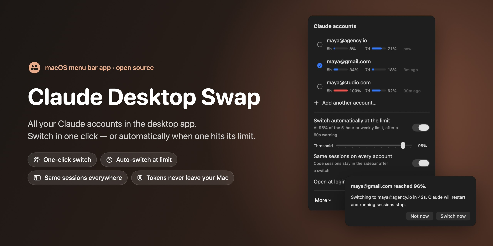
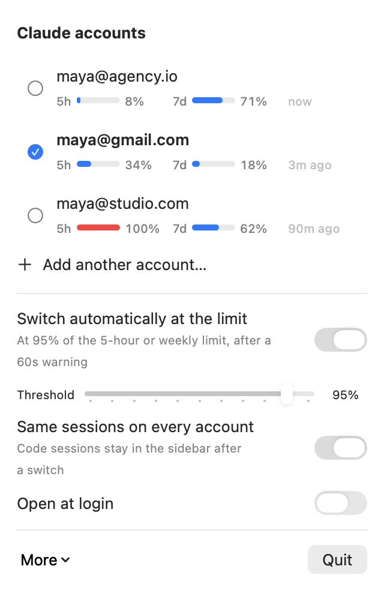
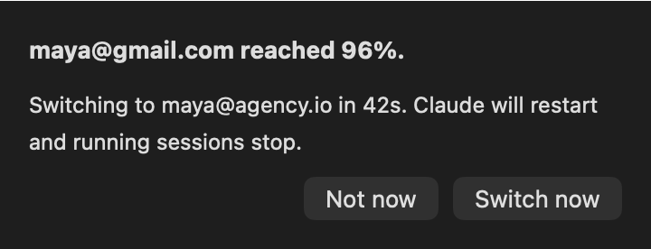

<p align="center">
  
</p>

<p align="center">
  <a href="../../releases/latest"></a>
  
  
  <a href="LICENSE"></a>
</p>

# Claude Desktop Swap

**Have more than one Claude subscription? Use them all in the Claude desktop
app.** Claude Desktop Swap puts your accounts in the menu bar. Click one and
Claude reopens signed in as it: no password, no email code. When an account
hits its 5-hour or weekly limit, it can move you to the next account on its own.

> [claude-swap](https://github.com/realiti4/claude-swap) does this for the
> `claude` CLI in a terminal. The desktop app keeps its sign-in elsewhere,
> so terminal tools can't switch it. This one can.

## Features

|  |  |
|---|---|
| ⚡️ **One-click switching** | Pick an account in the menu bar. Claude restarts signed in as it. |
| 📊 **Usage at a glance** | The 5-hour and weekly usage of every account, as Claude last recorded it. |
| 🔁 **Auto-switch at the limit** | At your threshold (95% by default), a 60-second warning appears, then Claude moves to the next account that has room. One click cancels. |
| 🗂 **Same sidebar on every account** | Your Code sessions stay listed after a switch, instead of each account showing an empty sidebar. |
| 🔒 **Nothing leaves your Mac** | It copies Claude's own files on disk. It never reads, decrypts or sends your tokens, and it makes no network calls. |
| ⌨️ **CLI included** | `cdswap switch`, `cdswap auto`, `cdswap list --json` for scripts. |

<p align="center">
  
  &nbsp;&nbsp;
  
</p>

## Install

1. Download **[ClaudeDesktopSwap.zip](../../releases/latest/download/ClaudeDesktopSwap.zip)**,
   unzip it, and drag **Claude Desktop Swap** into Applications.
2. The app isn't notarized yet. The first time, right-click it and choose
   **Open**. Or run:
   ```bash
   xattr -dr com.apple.quarantine "/Applications/Claude Desktop Swap.app"
   ```
3. A 👥 icon appears in your menu bar.

You need macOS 13 or later and the [Claude desktop app](https://claude.ai/download).

## Set up (2 minutes)

1. In Claude, sign in with your first account. Open the menu and click
   **Save this account**. It reads the email from Claude, so there's
   nothing to type.
2. Click **Add another account…**. Claude reopens signed out. Sign in with
   your next account and save it. Repeat for each account.
3. Done. Click any account to switch. Turn on **Switch automatically at the
   limit** if you want hands-off switching.

> [!IMPORTANT]
> A switch restarts Claude, so any running chat or Code session stops.
> Auto-switch always warns first, and never switches twice within 10 minutes.

> [!TIP]
> Claude records usage only if you've opened its usage view in the last
> 24 hours. Open it once a day and auto-switch always has fresh numbers. The menu warns you when readings go
> stale.

## FAQ

**Will I lose my chats or sessions?**
No. Chats live in your Claude account online. Code sessions stay on your Mac,
and with **Same sessions on every account** turned on (the default), every
account shows them. Every switch backs up the sign-in first, and **More → Undo
last switch** puts it back.

**Is it safe? Where are my credentials?**
Your sign-in stays where Claude puts it: in its own folder, encrypted with
your Mac's Keychain. Claude Desktop Swap keeps a copy per account in
`~/Library/Application Support/Claude Desktop Swap`, readable only by you.
Those copies only work on this Mac. The app has no network code at all.

**How does it know my usage?**
While Claude runs, it writes your usage percentages to
`plan-usage-history.json` every ~10 minutes. Claude Desktop Swap reads that
file and credits each new reading to the account signed in at that moment.

**Does it switch the `claude` CLI too?**
No, only the desktop app and its Code tab. For the terminal CLI, use
[claude-swap](https://github.com/realiti4/claude-swap).

**Windows?**
Not yet. The desktop app keeps the same layout under `%APPDATA%\Claude`, so
a port is possible. Pull requests are welcome.

## Command line

The CLI ships inside the app. To put it on your PATH:

```bash
ln -s "/Applications/Claude Desktop Swap.app/Contents/MacOS/cdswap" /usr/local/bin/cdswap
```

```text
cdswap                      who is signed in, with usage
cdswap list [--json]        saved accounts and their usage
cdswap add [name]           save the signed-in account (defaults to its email)
cdswap switch [name]        switch account (no name: the next one)
cdswap new                  sign out to add another account
cdswap auto [--once|--dry-run]   auto-switch without the menu bar app
cdswap share [--dry-run]    same Code sessions on every account
cdswap undo                 restore the sign-in from before the last switch
cdswap hook "<command>"     run something after each switch, while Claude is closed
cdswap config threshold 90  · autoSwitch true · countdown 30
```

If you run it from a Code tab inside Claude, it finishes the switch in the
background, because quitting Claude would otherwise stop it.

## How it works

Claude keeps its sign-in in a small part of
`~/Library/Application Support/Claude`:

- the claude.ai cookies
- its web storage (`Local Storage`, `IndexedDB`, `Session Storage`, `WebStorage`)
- three keys in `config.json`

A switch:

1. Quits Claude and waits for it to exit.
2. Backs up the current sign-in (the last 10 are kept).
3. Saves the current account's files, so tokens Claude refreshed while you
   worked are kept.
4. Copies the next account's files into place.
5. Reopens Claude.

Everything else is left alone: settings, MCP servers, Code sessions, VM
images. If any step fails, the backup goes back in.

**Sessions.** Claude files Code sessions per account under
`claude-code-sessions/<account>/<org>/`. Sharing keeps one real folder and
turns the others into symlinks to it. It brings their files over first:

- A session found on both sides keeps its newest copy.
- Index files, such as scheduled tasks, are merged entry by entry.
- Anything replaced is kept in `share-conflicts/`.
- A folder reached through a symlink is only ever copied from, never
  emptied.

## Build from source

```bash
swift build                    # Xcode 15+ toolchain
python3 tests/test_cli.py      # end-to-end tests on a fake Claude folder (never the real app)
scripts/build-app.sh 0.1.0     # universal .app + zip in dist/
scripts/screenshots.sh && swift scripts/render-cover.swift   # README images, from demo data
```

The code has three parts:

- `Sources/SwapCore`: the swap, sharing and usage logic
- `Sources/cdswap`: the CLI
- `Sources/ClaudeSwapApp`: the menu bar app

## Status

**Beta.** The switch logic is tested end to end on copies of a real Claude
data folder, where the round trip comes back byte for byte identical. Claude's
file layout isn't a public API, though, so a Claude update can change it. If
something looks off, use **Undo last switch** and
[open an issue](../../issues).

## Disclaimer

This is an independent open-source project. It is not affiliated with,
endorsed by or supported by Anthropic. "Claude" is a trademark of Anthropic.

Use only accounts you own or are allowed to use. Anthropic's terms govern
how you use Claude, including usage limits and account rules. Make sure your
use complies; that is your responsibility. The software comes without
warranty (see [LICENSE](LICENSE)).
